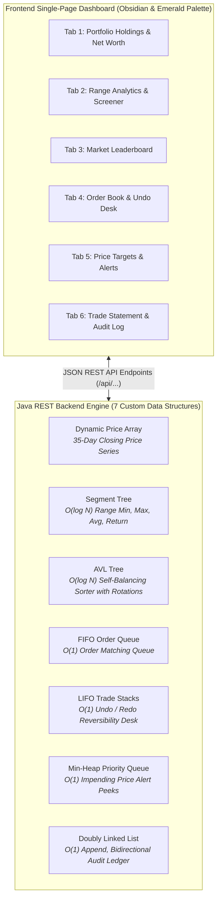

# ALGORISE — Real-Time Algorithmic Stock Market Portfolio Tracker
### Complete Project Manual, Architectural Analysis & 12-Slide PPT Presentation Deck

* **Live Web Application:** [https://algorise-virid.vercel.app](https://algorise-virid.vercel.app)
* **GitHub Repository:** [https://github.com/AGASTIYA07/algorise](https://github.com/AGASTIYA07/algorise)
* **Author Team:** 4-Member Engineering Collaboration

---

# TABLE OF CONTENTS
1. [PART 1: COMPREHENSIVE PROJECT EXPLANATION & FEATURES MANUAL](#part-1-comprehensive-project-explanation--features-manual)
   * 1.1 Executive Summary & Problem Statement
   * 1.2 System Architecture & Operational Workflow
   * 1.3 Detailed Tab-by-Tab Breakdown (Tabs 1 to 6)
   * 1.4 Financial Terminology Glossary (Bracketed Reference)
   * 1.5 4-Member Modular Engineering Architecture
2. [PART 2: COMPLETE 12-SLIDE PPT PRESENTATION DECK (WITH SPEAKER NOTES)](#part-2-complete-12-slide-ppt-presentation-deck-with-speaker-notes)
   * Slide 1: Title & Project Overview
   * Slide 2: Problem Statement & Engineering Motivation
   * Slide 3: System Architecture & Data Structure Mapping
   * Slide 4: Tab 1 — Portfolio Holdings & Dynamic Price Array
   * Slide 5: Tab 2 — Range Analytics & Segment Tree Deep Dive
   * Slide 6: Tab 3 — Market Leaderboard & AVL Tree
   * Slide 7: Tab 4 — Order Book (Queue) & Trade Reversibility (Stack)
   * Slide 8: Tab 5 — Price Targets & Min-Heap Priority Queue
   * Slide 9: Tab 6 — Trade Statement & Doubly Linked List
   * Slide 10: Master Data Structure Complexity Comparison Matrix
   * Slide 11: Real-World FinTech Concepts & Accounting Mechanics
   * Slide 12: Team Contributions, Cloud Deployment & Conclusion

---

# PART 1: COMPREHENSIVE PROJECT EXPLANATION & FEATURES MANUAL

## 1.1 Executive Summary & Problem Statement

### What is Algorise?
**Algorise** is a high-performance, real-time stock portfolio intelligence platform and order execution terminal built from the ground up in Java. It allows retail and institutional investors to track multi-stock holdings, simulate market trading days, calculate complex range statistics over historical prices, sort top market performers, queue pending orders, reverse accidental executions with zero slippage, and maintain an immutable chronological trade audit log.

### The Problem It Solves
Traditional web-based financial software relies on relational databases (SQL) or NoSQL document stores to handle portfolio computations. When analyzing historical stock data across multiple time horizons (such as 7-day, 14-day, or 30-day windows), traditional database queries execute linear table scans (`O(N)`). During fast-moving market trading sessions, this results in:
* High database CPU load and slow API response times.
* Race conditions and order execution bottlenecks.
* Unpredictable query latency during market volatility.

### The Algorise Solution
Algorise replaces external databases with **7 custom foundational Data Structures** implemented in pure Java:
1. **Segment Tree:** For `O(log N)` historical price range queries (Min, Max, Average, Return).
2. **AVL Tree:** For `O(log N)` self-balancing market gainers/losers leaderboard sorting.
3. **Min-Heap:** For `O(1)` constant-time detection of impending price threshold alerts.
4. **FIFO Order Queue:** For `O(1)` deterministic, fair order book matching.
5. **LIFO Trade Stacks:** For `O(1)` zero-slippage trade reversibility (Undo/Redo Desk).
6. **Doubly Linked List:** For `O(1)` append and bidirectional (`O(N)`) audit statement traversal.
7. **Dynamic Price Array:** For `O(1)` indexed time-series historical price retrieval.

---

## 1.2 System Architecture & Operational Workflow

### End-to-End Operational Lifecycle:
1. **Initial Market State:** The application initializes with 10 diversified blue-chip stocks (`AAPL`, `NVDA`, `TSLA`, `MSFT`, `GOOGL`, `AMZN`, `META`, `NFLX`, `AMD`, `JPM`) across 35 consecutive trading days of realistic historical closing prices.
2. **The "Next Trading Session" Cascade Effect:** When the user clicks **Next Trading Session** on Tab 1, a simulated market tick generates new closing prices. This single action triggers an immediate cascade across multiple data structures simultaneously:
   * **Dynamic Price Array:** Appends the new closing price to each stock's historical sequence in `O(1)` amortized time.
   * **Segment Tree:** Updates leaf nodes and recalculates internal range statistics in `O(log N)` time.
   * **AVL Tree:** Re-inserts nodes with new percent changes and executes balancing rotations (LL, RR, LR, RL) in `O(log N)` time to maintain height balance.
   * **Min-Heap:** Peeks at root `H[0]` in `O(1)` time to evaluate if any target thresholds have been breached.
3. **Trade Lifecycle (Queue -> Stack -> Linked List):**
   * Orders are queued into the FIFO `OrderQueue`.
   * Dequeued orders settle cash and positions, push a reversal action to the LIFO `TradeStack`, and append an immutable record to the `TransactionList` (Doubly Linked List).
   * Clicking **Undo Trade** pops the `TradeStack` in `O(1)`, restores funds, adjusts share counts, and unlinks the transaction from the audit ledger.

---

## 1.3 Detailed Tab-by-Tab Breakdown (Tabs 1 to 6)

### 🔹 Tab 1: My Portfolio & Holdings
* **Underlying Data Structure:** **Dynamic Price Array** (`ArrayList<Double>`) & **Portfolio Aggregator** (`Portfolio.java`).
* **Real-World Purpose:** Serves as the primary investment command center, calculating live net worth, cash buying power, cost basis, and unrealized gains.
* **How It Works:**
  * Aggregates cash reserves with the current market valuation of all held stock positions (`Shares Owned × Current Price`).
  * Displays cost basis (average purchase price per share), market valuation, unrealized profit & loss (P&L), and daily percent change.
  * Features the **Next Trading Session** simulation button, which simulates an active market day and recalculates all balances across the dashboard.
* **Key Code Methods:**
  * `Stock.applyTrade(String type, int shares, double price)` — `O(1)` updates holding shares and cost basis.
  * `Stock.addDailyPrice(double price)` — `O(1)` amortized append to dynamic array.

### 🔹 Tab 2: Range Analytics & Screener
* **Underlying Data Structure:** **Segment Tree** (`SegmentTree.java` / `SegmentTreeNode.java`).
* **Real-World Purpose:** Solves complex time-series queries: *"What was the exact lowest price, highest price, average price, and net return between any two dates [L, R]?"*
* **How It Works:**
  * Pre-builds a binary tree over historical closing prices in `O(N)` time.
  * Queries range minimums, maximums, and averages over any arbitrary window `[L, R]` in `O(log N)` time by decomposing queries into canonical intervals.
  * **Top Performer Screener:** Queries the Segment Tree across all 10 stocks over preset time horizons (**7 Days**, **14 Days**, **30 Days**, **All-Time**) to highlight the #1, #2, and #3 top-performing stocks.
  * **Custom Range Inspector:** Computes exact low, high, average, and return statistics for user-entered day boundaries (e.g. Day 10 to Day 25) with Chart.js visualization.
* **Key Code Methods:**
  * `SegmentTree.queryRange(int ql, int qr)` — `O(log N)` queries range minimum, maximum, and sum.
  * `SegmentTree.updatePrice(int index, double newPrice)` — `O(log N)` updates a single day's closing price.

### 🔹 Tab 3: Market Leaderboard
* **Underlying Data Structure:** **AVL Tree** (`AVLTree.java` / `AVLNode.java`).
* **Real-World Purpose:** Provides a real-time ranked leaderboard of market gainers and losers from best performer to worst performer.
* **How It Works:**
  * Maintains a strictly balanced binary search tree indexed by daily session percentage change.
  * Every node tracks a balance factor (`Height(left) - Height(right) ∈ {-1, 0, 1}`). When an insertion or price tick causes an imbalance, single (LL, RR) or double (LR, RL) rotations restore balance in `O(log N)` time.
  * An **In-Order Traversal** (right-root-left descending order) extracts all 10 stocks sorted from #1 top gainer to #10 worst performer in `O(N)` traversal time.
* **Key Code Methods:**
  * `AVLTree.insert(Stock stock)` — `O(log N)` inserts and balances node via rotations.
  * `AVLTree.inOrderTraversal()` — `O(N)` outputs strictly sorted descending ranking.

### 🔹 Tab 4: Order Book & Undo
* **Underlying Data Structures:** **FIFO Order Queue** (`OrderQueue.java`) & **LIFO Trade Stack** (`TradeStack.java`).
* **Real-World Purpose:** Sequential order routing and accidental trade reversibility with zero slippage.
* **How It Works:**
  * **Order Book (FIFO Queue):** Orders submitted in "Add to Order Queue" mode wait sequentially in arrival order. Enqueue and dequeue operations run in `O(1)` time using head and tail pointers.
  * **Trade Reversibility Desk (LIFO Stack):** Executed trades are pushed onto an Undo Stack. Clicking **Undo Trade** pops the most recent trade in `O(1)` time, immediately refunding cash, restoring share holdings, and transferring the action to a Redo Stack for forward/backward flexibility.
* **Key Code Methods:**
  * `OrderQueue.enqueue(Trade trade)` — `O(1)` appends trade to queue tail.
  * `OrderQueue.dequeue()` — `O(1)` dispatches trade from queue head.
  * `TradeStack.push(Trade trade)` / `TradeStack.pop()` — `O(1)` push and pop reversibility.

### 🔹 Tab 5: Price Targets & Alerts
* **Underlying Data Structure:** **Min-Heap** (`MinHeap.java`).
* **Real-World Purpose:** Automated price threshold monitoring for taking profit or buying market dips.
* **How It Works:**
  * Stores threshold price alerts in a complete binary tree where the lowest target price always resides at root `H[0]`.
  * Checking if the nearest price target is triggered requires only an `O(1)` peek at the root.
  * Inserting a new alert or removing an alert runs in `O(log N)` time using sift-up and sift-down heapify operations.
  * When a stock's price crosses an alert threshold during session simulation, the alert triggers immediately with an on-screen toast alert.
* **Key Code Methods:**
  * `MinHeap.peek()` — `O(1)` inspects lowest target threshold.
  * `MinHeap.insert(PriceAlert alert)` — `O(log N)` inserts and sifts up.
  * `MinHeap.extractMin()` — `O(log N)` pops root and sifts down.

### 🔹 Tab 6: Trade Statement
* **Underlying Data Structure:** **Doubly Linked List** (`TransactionList.java` / `TransactionNode.java`).
* **Real-World Purpose:** Permanent chronological audit ledger of every executed transaction.
* **How It Works:**
  * Every completed order is stored as an immutable node containing Trade ID, Timestamp, Action (BUY/SELL), Quantity, Execution Price, and Total Net Amount.
  * Each node contains both `prev` and `next` pointers, enabling `O(1)` tail appends.
  * Features a bidirectional traversal toggle: **View: Newest First** traverses backward from `tail` to `head` in `O(N)`, while **View: Oldest First** traverses forward from `head` to `tail` in `O(N)` without copying or re-sorting memory.
* **Key Code Methods:**
  * `TransactionList.addTransaction(Trade trade)` — `O(1)` appends node to tail.
  * `TransactionList.toList(boolean reverse)` — `O(N)` forward/backward pointer traversal.

---

## 1.4 Financial Terminology Glossary

* **Portfolio Net Worth [Total Valuation]:** The combined sum of all available cash plus the current market value of all held stock shares (`Cash + Sum(Shares × Current Price)`).
* **Cost Basis [Average Buy Price]:** The average purchase price paid per share for a stock position (`Total Money Spent / Total Shares Owned`).
* **Unrealized Profit & Loss (P&L) [Paper Profit/Loss]:** The profit or loss on currently open positions that have not yet been sold (`Current Market Value - Total Cost Basis`). It becomes *realized* only after selling.
* **Buying Power [Available Cash]:** The simulated uninvested liquid cash balance available in the account to place new buy orders.
* **Slippage [Execution Difference]:** The difference between the expected price of a trade and the actual execution price. The Undo Desk provides *zero-slippage* trade reversibility.
* **Bullish vs. Bearish [Market Direction]:** **Bullish** refers to upward price movement (+ daily change %); **Bearish** refers to downward price movement (- daily change %).

---

## 1.5 4-Member Modular Engineering Architecture

The codebase is cleanly separated into 4 decoupled engineering modules:

1. **Part 1 (Algorithmic Core & Range Analytics):**  
   * `Stock.java`, `Trade.java`, `SegmentTree.java`, `SegmentTreeNode.java`
   * *Responsibilities:* Closing price series, financial metrics calculation, Segment Tree construction, interval query decomposition.
2. **Part 2 (Market Ranking & Priority Alerts):**  
   * `AVLTree.java`, `AVLNode.java`, `MinHeap.java`, `PriceAlert.java`
   * *Responsibilities:* AVL self-balancing tree, LL/RR/LR/RL rotations, in-order ranking, Min-Heap priority queue, price target threshold monitoring.
3. **Part 3 (Order Execution, Reversibility & Audit Statement):**  
   * `OrderQueue.java`, `OrderNode.java`, `TradeStack.java`, `TradeStackNode.java`, `TransactionList.java`, `TransactionNode.java`
   * *Responsibilities:* FIFO order matching queue, LIFO trade reversibility Undo/Redo desk, Doubly Linked List bidirectional transaction statement.
4. **Part 4 (System Controller, REST API Server & UI Dashboard):**  
   * `Portfolio.java`, `StockMarketWebServer.java`, `StockMarketApp.java`, `web/index.html`, `Dockerfile`, `README.md`
   * *Responsibilities:* Master portfolio aggregator, embedded Java HTTP REST server, responsive Obsidian & Emerald web UI, Docker containerization, and cloud deployment.

---
---

# PART 2: COMPLETE 12-SLIDE PPT PRESENTATION DECK (WITH SPEAKER NOTES)

---

### 🖥️ SLIDE 1: Title & Project Overview

#### Slide Content:
# ALGORISE
### Real-Time Algorithmic Stock Market Portfolio Tracker
**Powered by 7 Custom Data Structures in Java**

* **Live Deployment:** [https://algorise-virid.vercel.app](https://algorise-virid.vercel.app)
* **GitHub Repository:** [https://github.com/AGASTIYA07/algorise](https://github.com/AGASTIYA07/algorise)
* **Engineering Team:** 4-Member Collaborative Development

#### Key Visual:
* Screenshot of the Algorise Obsidian & Emerald dashboard with the live portfolio valuation, holdings table, and interactive charts.

#### Speaker Notes (What to Say):
> *"Good morning respected evaluators. Today we present Algorise, a real-time algorithmic stock market portfolio platform. Most modern financial apps depend on bloated database queries that introduce latency during rapid market shifts. In Algorise, we replaced database dependencies with 7 foundational data structures in Java, achieving optimal Big-O algorithmic performance across all features. The project is deployed live at algorise-virid.vercel.app."*

---

### 🖥️ SLIDE 2: Problem Statement & Engineering Motivation

#### Slide Content:
## The Problem: Database Bottlenecks in Financial Systems
* **The Latency Problem:** Relational SQL databases scan rows sequentially (`O(N)`), introducing query bottlenecks during volatile market spikes.
* **The Financial Need:** Investors require instant answers to multi-period questions:
  * *"What was the period low, high, and average over the last 30 days?"*
  * *"Which stock had the highest percentage gain today?"*
  * *"Are any price alert thresholds breached?"*
* **The Algorise Solution:**
  * Replace high-overhead database queries with tailor-made in-memory data structures.
  * Guarantee sub-linear time complexities: `O(1)` and `O(log N)` for all critical financial operations.

#### Speaker Notes (What to Say):
> *"In financial markets, speed and determinism are everything. If an investor wants to calculate the period low, high, and average price over the last 30 days, scanning every single day linearly in O(N) time is inefficient when tracking multiple assets. By engineering custom data structures tailored to each financial operation, we achieved O(log N) and O(1) execution times across the board."*

---

### 🖥️ SLIDE 3: System Architecture & Data Structure Mapping

#### Slide Content:
## System Architecture & Data Structure Mapping

| Financial Operation | Tab in Algorise | Chosen Data Structure | Time Complexity |
| :--- | :--- | :--- | :---: |
| **Historical Price Series** | Tab 1: Portfolio Holdings | Dynamic Price Array | `O(1)` Lookup |
| **Range Min/Max/Avg Analytics** | Tab 2: Range Screener | ⭐ Segment Tree | `O(log N)` Query |
| **Performance Leaderboard** | Tab 3: Market Leaderboard | 🌳 AVL Tree | `O(log N)` Balance |
| **Order Book Matching** | Tab 4: Order Book & Undo | 📋 Queue (FIFO) | `O(1)` Push/Pop |
| **Trade Reversibility Desk** | Tab 4: Order Book & Undo | ↩️ Stack (LIFO) | `O(1)` Push/Pop |
| **Price Target Alerts** | Tab 5: Targets & Alerts | 📊 Min-Heap | `O(1)` Peek |
| **Trade Statement Ledger** | Tab 6: Trade Statement | 🔗 Doubly Linked List | `O(1)` Append |

#### Speaker Notes (What to Say):
> *"Here is the architectural blueprint of Algorise. We have 6 interactive dashboard tabs, each mapped to a dedicated data structure. For example, our 30-day range analytics is powered by a Segment Tree, market ranking by an AVL Tree, and price alerts by a Min-Heap. Let us now examine each data structure and why it was chosen."*

---

### 🖥️ SLIDE 4: Tab 1 — Portfolio Holdings & Dynamic Price Array

#### Slide Content:
## Tab 1: Portfolio Valuation & Dynamic Price Array
* **Data Structure:** Dynamic Price Array (`ArrayList<Double>`)
* **Financial Metrics Computed:**
  * **Portfolio Net Worth [Total Valuation]:** `Cash + Sum(Shares × Price)`
  * **Cost Basis [Average Buy Price]:** `Total Cost / Shares Owned`
  * **Unrealized P&L [Paper Gain/Loss]:** `Market Value - Cost Basis`
* **Array Efficiency:**
  * Direct index access (`prices.get(dayIndex)`) runs in `O(1)` time.
  * Daily price append on session advancement runs in `O(1)` amortized time.
* **Market Simulation:** Advancing a market session ticks closing prices across all 10 stocks simultaneously.

#### Speaker Notes (What to Say):
> *"Tab 1 represents the investor's core command center. It aggregates total portfolio value, cash buying power, and cost basis. We use a Dynamic Price Array for each stock's historical closing prices. Because closing prices are sequentially indexed by day number, an array allows instant O(1) lookups by day index without searching."*

---

### 🖥️ SLIDE 5: Tab 2 — Range Analytics & Segment Tree Deep Dive

#### Slide Content:
## Tab 2: Range Analytics Powered by Segment Tree
* **Data Structure:** ⭐ **Segment Tree** (`SegmentTree.java` / `SegmentTreeNode.java`)
* **Why Segment Tree? (Comparative Analysis):**
  * *Linear Scan:* Takes `O(N)` for every range query -> Too slow for repeated lookups.
  * *Prefix Sum Array:* Takes `O(1)` for sum, but **fails** for range min/max and takes `O(N)` on price updates!
  * *Segment Tree (Our Choice):* Delivers `O(log N)` range min, max, average, AND `O(log N)` point updates!
* **Core Capabilities:**
  * **Range Query Decomposition:** Any arbitrary query `[L, R]` decomposes into at most `2 × ⌈log₂ N⌉` canonical node intervals.
  * **30-Day Range Screener:** Evaluates all 10 stocks across preset windows (7, 14, 30, All-Time) to determine podium rankers.
  * **Custom Range Inspector:** Computes exact statistics between user-entered day boundaries with Chart.js visualization.

#### Speaker Notes (What to Say):
> *"The Segment Tree is our flagship algorithmic component. In institutional finance, investors frequently ask: 'What was the lowest, highest, and average price between Day 10 and Day 25?' A simple linear scan takes O(N). Prefix sums only solve the sum, not the minimum or maximum. The Segment Tree answers range min, max, average, and return simultaneously in O(log N) time, while allowing new prices to be inserted in O(log N) time as well."*

---

### 🖥️ SLIDE 6: Tab 3 — Market Leaderboard & AVL Tree

#### Slide Content:
## Tab 3: Dynamic Leaderboard Powered by AVL Tree
* **Data Structure:** 🌳 **AVL Tree** (Self-Balancing Binary Search Tree)
* **Why AVL Tree? (Comparative Analysis):**
  * *Standard BST:* Can degenerate into a skewed linked list with `O(N)` height if prices arrive in sorted order.
  * *Sorting Array on Every Tick (Quicksort):* Takes `O(N log N)` every time a stock price changes.
  * *AVL Tree (Our Choice):* Guarantees a strictly balanced tree with height `h ≤ 1.44 log₂ N`. Rebalancing takes only `O(log N)`.
* **Core Capabilities:**
  * **Tree Rotations:** Automatically executes Left-Left (LL), Right-Right (RR), Left-Right (LR), or Right-Left (RL) rotations when balance factor deviates (`|BF| > 1`).
  * **Descending Leaderboard:** An In-Order Traversal (right-to-left) extracts all 10 stocks sorted from highest bull (#1) to lowest bear (#10) in `O(N)` time.

#### Speaker Notes (What to Say):
> *"Tab 3 is our Market Leaderboard, ranking the top movers in real time. We used an AVL Tree, a self-balancing binary search tree. If we used a standard BST, inserting trending stocks could degenerate the tree into a linked list of O(N) height. The AVL tree tracks balance factors and automatically applies LL, RR, LR, or RL rotations to guarantee a strict O(log N) height bound. A descending in-order traversal gives us the fully sorted leaderboard in O(N) time."*

---

### 🖥️ SLIDE 7: Tab 4 — Order Book (Queue) & Trade Reversibility (Stack)

#### Slide Content:
## Tab 4: Order Matching (FIFO) & Trade Reversibility (LIFO)
* **Data Structures:** 📋 **FIFO OrderQueue** & ↩️ **LIFO TradeStack**
* **Part A: Order Book Matching (FIFO Queue):**
  * Enforces fair sequential order routing: the first order submitted is the first executed.
  * Head and tail pointer management ensures `O(1)` enqueue and dequeue operations.
  * Prevents order starvation and maintains fair matching priority.
* **Part B: Trade Reversibility Desk (LIFO Stack):**
  * Every filled trade is pushed onto an Undo Stack.
  * Clicking **Undo Trade** pops the most recent trade in `O(1)` time.
  * Instantly restores cash balance, reverts share holdings, and transfers the action to a Redo Stack.
  * Guarantees **zero slippage** for accidental executions.

#### Speaker Notes (What to Say):
> *"Tab 4 handles trade execution and safety. We implemented two fundamental linear data structures: a FIFO Queue and a LIFO Stack. The Order Queue ensures orders are executed fairly in the exact order they arrive in O(1) time. Meanwhile, the Trade Reversibility Desk uses an Undo Stack. If a trader accidentally places an incorrect market order, clicking 'Undo Trade' pops the top trade in O(1) time, refunds cash, and restores share counts with zero slippage."*

---

### 🖥️ SLIDE 8: Tab 5 — Price Targets & Min-Heap Priority Queue

#### Slide Content:
## Tab 5: Automated Price Alerts via Min-Heap
* **Data Structure:** 📊 **Min-Heap** (`MinHeap.java`)
* **Why Min-Heap? (Comparative Analysis):**
  * *Unsorted List:* Takes `O(N)` scan on every market tick to check if any alert triggered.
  * *Sorted List:* Takes `O(N)` insertion time when adding a new alert.
  * *Min-Heap (Our Choice):* Lowest threshold sits at root `H[0]`. Checking the nearest alert takes `O(1)` time; inserting takes `O(log N)`.
* **Core Capabilities:**
  * **Heap Invariant:** Parent key is always less than or equal to children (`A[parent] ≤ A[child]`).
  * **Sift-Up & Sift-Down:** New threshold targets bubble up in `O(log N)`; triggered alerts are removed and the heap is restored via downward heapify in `O(log N)`.
  * **Real-time Trigger:** During session price updates, the root is peeked in `O(1)` time, firing toast notifications when targets are breached.

#### Speaker Notes (What to Say):
> *"In Tab 5, traders set automated threshold alerts—for instance, notifying them when Tesla drops below \$260 or Apple crosses \$195. Rather than scanning all alerts linearly on every price tick, we use a Min-Heap. The alert closest to triggering is always at the root of the heap. Checking if an alert has been breached takes instant O(1) peek time, and inserting new alerts takes O(log N) using sift-up operations."*

---

### 🖥️ SLIDE 9: Tab 6 — Trade Statement & Doubly Linked List

#### Slide Content:
## Tab 6: Immutable Audit Statement via Doubly Linked List
* **Data Structure:** 🔗 **Doubly Linked List** (`TransactionList.java` / `TransactionNode.java`)
* **Why Doubly Linked List? (Comparative Analysis):**
  * *Array / ArrayList:* Adding to the front or removing historical records takes `O(N)` shifting overhead.
  * *Singly Linked List:* Can only traverse forward; backward audit inspection requires `O(N)` stack overhead.
  * *Doubly Linked List (Our Choice):* `O(1)` insertion at tail; seamless forward (`head -> tail`) and reverse (`tail -> head`) traversal without memory re-allocation.
* **Core Capabilities:**
  * **Node Structure:** Contains `tradeId`, `timestamp`, `symbol`, `type` (BUY/SELL), `quantity`, `price`, `total`, plus `next` and `prev` pointers.
  * **Bidirectional View Toggle:**
    * *Newest First:* Traverses backward from `tail` via `prev` pointers in `O(N)` time.
    * *Oldest First:* Traverses forward from `head` via `next` pointers in `O(N)` time.

#### Speaker Notes (What to Say):
> *"Tab 6 provides an unforgeable, chronological trade statement. Compliance and auditing require both chronological (oldest first) and reverse (newest first) inspections. A Doubly Linked List is ideal: each transaction node holds both a next and previous pointer. Inserting new trades at the tail takes O(1) time, and toggling between newest-first and oldest-first view traverses pointers directly without copying or re-sorting arrays."*

---

### 🖥️ SLIDE 10: Master Data Structure Complexity Comparison Matrix

#### Slide Content:
## Algorithmic Performance & Complexity Matrix

| Data Structure | Operations Analyzed | Algorise Time Complexity | Naive Alternative Complexity | Efficiency Gain |
| :--- | :--- | :---: | :---: | :--- |
| **Segment Tree** | Range Query `[L, R]` | **`O(log N)`** | `O(N)` Linear Scan | **Exponential speedup** for large histories |
| **Segment Tree** | Daily Price Point Update | **`O(log N)`** | `O(N)` Re-scan | **Logarithmic update propagation** |
| **AVL Tree** | Insert & Rebalance | **`O(log N)`** | `O(N)` Unbalanced BST | **Guaranteed balanced height** (`h ≤ 1.44 log₂ N`) |
| **AVL Tree** | Descending Ranking Traversal | **`O(N)`** | `O(N log N)` Full Sort | **Linear traversal** without re-sorting |
| **Min-Heap** | Check Impending Alert | **`O(1)`** | `O(N)` Full Array Scan | **Instant root peek** |
| **Min-Heap** | Insert Price Alert | **`O(log N)`** | `O(N)` Sorted Insertion | **Logarithmic sift-up** |
| **Order Queue** | Enqueue / Dequeue Order | **`O(1)`** | `O(N)` Array Shift | **Constant-time queue operations** |
| **Trade Stack** | Push Executed / Pop Undo | **`O(1)`** | `O(N)` Array Shift | **Zero-latency reversibility desk** |
| **Doubly Linked List** | Append Trade / Reverse View | **`O(1)`** append / **`O(N)`** view | `O(N)` Array copy & reverse | **Pointer-based bidirectional traversal** |

#### Speaker Notes (What to Say):
> *"This table summarizes our complexity analysis. In every single component, we eliminated linear O(N) bottlenecks. Our Segment Tree performs range queries in O(log N) rather than O(N). Our Min-Heap peeks alerts in O(1) rather than scanning an entire table. Our Order Queue and Trade Stack push and pop in O(1) time. This ensures our application remains instantaneous regardless of market volume."*

---

### 🖥️ SLIDE 11: Real-World FinTech Concepts Explained

#### Slide Content:
## Financial Concepts Integrated in Algorise
* **Portfolio Valuation:** Continuous mark-to-market valuation combining liquid buying power with equity value.
* **Cost Basis Calculation:** Running weighted average purchase price per share across multiple trade executions.
* **Unrealized vs. Realized P&L:** Real-time paper gain/loss accounting versus realized cash profit upon closing positions.
* **Zero-Slippage Reversibility:** Simulates an institutional trade desk capability where erroneous trades are un-executed without market penalty.
* **Proximity Alert Triggering:** Automated notification triggers for take-profit and stop-loss/dip-buying strategies.

#### Speaker Notes (What to Say):
> *"Algorise is not just a theoretical data structure exercise; it faithfully reproduces institutional financial mechanics. It dynamically tracks cost basis using weighted averages, computes unrealized profit and loss in real time, and eliminates execution slippage via our Undo Desk. Traders can set profit-taking thresholds and buy-the-dip targets with immediate visual feedback."*

---

### 🖥️ SLIDE 12: Team Contributions, Deployment & Live Demo

#### Slide Content:
## Team Engineering Contributions & Live Project Links
* **Live Deployment:** [https://algorise-virid.vercel.app](https://algorise-virid.vercel.app)
* **GitHub Repository:** [https://github.com/AGASTIYA07/algorise](https://github.com/AGASTIYA07/algorise)
* **Team Contribution Breakdown (4 Members):**
  * **Person 1 (Algorithmic Core):** Domain models (`Stock.java`, `Trade.java`) and `SegmentTree.java` engine.
  * **Person 2 (Trees & Priority Queues):** `AVLTree.java` leaderboard with rotations and `MinHeap.java` price alerts.
  * **Person 3 (Execution & Audit):** FIFO `OrderQueue.java`, LIFO `TradeStack.java`, and `TransactionList.java` Doubly Linked List.
  * **Person 4 (Full-Stack & DevOps):** `Portfolio.java` master controller, `StockMarketWebServer.java` REST API, Obsidian & Emerald UI dashboard (`web/index.html`), and cloud deployment.
* **Project Verification:**
  * Fully deployed on Vercel Global Edge CDN and GitHub Pages.
  * Verified 16/16 Java files compiling with 0 errors.

#### Speaker Notes (What to Say):
> *"To conclude, Algorise was collaboratively engineered by our team of 4, with clearly separated modular responsibilities. All code has been pushed to GitHub, verified across all 16 Java classes, and deployed live at algorise-virid.vercel.app. We invite you to test the live application as we demonstrate our live interactive demo. Thank you, and we welcome your questions."*
