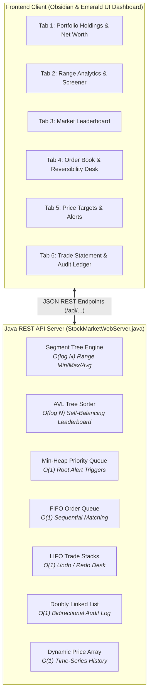

# Algorise — Real-Time Algorithmic Stock Market Portfolio Tracker

**Algorise** is a consumer-grade, real-time financial portfolio intelligence dashboard and order execution terminal built from the ground up in Java. Instead of relying on external high-level database packages, **Algorise** powers all core market analytics, order dispatching, price ranking, and audit logging using **7 custom foundational Data Structures**.

---

## 🏗️ System Architecture & How the Project Works

### End-to-End Operational Flow:
1. **Initial Market State**: The application pre-loads 10 blue-chip stocks (`AAPL`, `NVDA`, `TSLA`, `MSFT`, `GOOGL`, `AMZN`, `META`, `NFLX`, `AMD`, `JPM`) across 35 consecutive trading days of realistic closing prices.
2. **Simulation Engine ("Next Trading Session")**: When the user advances a market day, new closing prices are generated for all 10 stocks. This single event cascades across multiple data structures simultaneously:
   * **Dynamic Price Array**: Appends the new closing price to each stock's historical sequence in `O(1)` amortized time.
   * **Segment Tree**: Executes an `O(log N)` point update on leaf nodes and propagates updated minimums, maximums, and sums to root nodes.
   * **AVL Tree**: Recalculates daily percent changes and executes tree rotations (LL, RR, LR, RL) in `O(log N)` to keep the leaderboard balanced.
   * **Min-Heap**: Performs an `O(1)` root inspection to check if any user-configured threshold alerts have been breached.
3. **Trade Execution & Reversibility Flow**:
   * Placing an order via **Add to Order Queue** pushes it to the back of the FIFO `OrderQueue`.
   * Clicking **Execute Next Order** dequeues the order from the front of the queue, updates cash and holdings, pushes a reversal action to the `TradeStack` (Undo Stack), and appends an immutable record to the `TransactionList` (Doubly Linked List).
   * Clicking **Undo Trade** pops the last executed trade from the `TradeStack`, restores cash, reverts share counts, and unlinks the node from the `TransactionList`.

---

## 🖥️ Dashboard Tabs & How Each Works

### Tab 1: My Portfolio & Holdings
* **Data Structure:** **Dynamic Price Array** (`ArrayList<Double>`) & **Portfolio Aggregator** (`Portfolio.java`)
* **Financial Purpose:** Consolidates total net worth, available cash buying power, unrealized profit & loss (P&L), and individual stock holding metrics.
* **How It Works:**
  * Aggregates cash with the live market value (`Shares Owned × Current Price`) of all positions.
  * Displays cost basis (average purchase price), market valuation, total return %, and daily session change.
  * Hosts the **Next Trading Session** simulation button, allowing users to advance the market by one day and observe dynamic portfolio recalculations.

### Tab 2: Range Analytics & Screener
* **Data Structure:** **Segment Tree** (`SegmentTree.java` / `SegmentTreeNode.java`)
* **Financial Purpose:** Answers institutional queries such as: *"What was the period low, high, average price, and net return over any arbitrary date range [L, R]?"*
* **How It Works:**
  * Pre-builds a binary tree over historical closing prices in `O(N)` time.
  * Queries range minimums, maximums, and averages across any arbitrary window `[L, R]` in `O(log N)` time by decomposing queries into canonical segment tree intervals.
  * **Top Performer Screener**: Uses the Segment Tree to rank the top 3 best-performing assets across preset lookback windows (**7 Days**, **14 Days**, **30 Days**, **All-Time**).
  * **Custom Range Inspector**: Computes exact statistics for user-entered boundaries (e.g. Day 10 to Day 25) with Chart.js visualization.

### Tab 3: Market Leaderboard
* **Data Structure:** **AVL Tree** (`AVLTree.java` / `AVLNode.java`)
* **Financial Purpose:** Real-time ranking of market gainers and losers from best performer to worst performer.
* **How It Works:**
  * Maintains a self-balancing binary search tree indexed by daily percentage change.
  * Automatically applies single (LL, RR) or double (LR, RL) tree rotations when height imbalances occur (`|balance factor| > 1`), maintaining a strict `O(log N)` height bound.
  * Performs an **In-Order Traversal** (right-root-left descending order) to output all stocks ranked from top gainer (#1) to lowest performer (#10) in `O(N)` traversal time.

### Tab 4: Order Book & Undo
* **Data Structures:** **FIFO Order Queue** (`OrderQueue.java`) & **LIFO Trade Stack** (`TradeStack.java`)
* **Financial Purpose:** Fair order routing and accidental trade reversibility with zero slippage.
* **How It Works:**
  * **Order Book (FIFO Queue)**: Pending trade orders wait sequentially in arrival order. Enqueue and dequeue operations run in `O(1)` time using head and tail pointers.
  * **Trade Reversibility Desk (LIFO Stack)**: Every executed trade is pushed onto an Undo Stack. Clicking **Undo Trade** pops the most recent trade, immediately refunding cash, restoring share holdings, and pushing the action onto a Redo Stack for forward/backward flexibility.

### Tab 5: Price Targets & Alerts
* **Data Structure:** **Min-Heap** (`MinHeap.java`)
* **Financial Purpose:** Automated price target monitoring for taking profit or buying market dips.
* **How It Works:**
  * Organizes active price target alerts in a binary min-heap where the lowest threshold sits at root `H[0]`.
  * Checking whether a target price has been reached requires only an `O(1)` peek of the heap root.
  * Inserting a new alert or removing an alert runs in `O(log N)` time using upward and downward heapify (sift-up / sift-down).
  * When a stock's price crosses an alert threshold during session simulation, the alert is popped and an interactive toast notification fires instantly.

### Tab 6: Trade Statement
* **Data Structure:** **Doubly Linked List** (`TransactionList.java` / `TransactionNode.java`)
* **Financial Purpose:** Official chronological audit trail of all completed buy and sell transactions.
* **How It Works:**
  * Each transaction record is stored as an immutable node containing Trade ID, Timestamp, Action (BUY/SELL), Quantity, Execution Price, and Total Net Amount.
  * Nodes feature both `prev` and `next` pointers.
  * Clicking **View: Newest First** traverses backward from `tail` to `head` in `O(N)`, while **View: Oldest First** traverses forward from `head` to `tail` in `O(N)` without copying or re-sorting memory.

---

## 📊 Data Structure Complexity Reference

| Data Structure | Feature Powered | Operation | Time Complexity | Purpose in Project |
| :--- | :--- | :--- | :---: | :--- |
| **Segment Tree** | Range Analytics `[L, R]` | Range Min/Max/Avg Query | `O(log N)` | Rapid multi-period analytics over historical prices without linear scans. |
| **Segment Tree** | Daily Price Update | Leaf Point Update | `O(log N)` | Updates historical tree branch in logarithmic time when new daily prices arrive. |
| **AVL Tree** | Market Leaderboard | Insert / Rebalance | `O(log N)` | Guarantees `O(log N)` height balance via rotations under dynamic price shifts. |
| **AVL Tree** | Market Leaderboard | Sorted Traversal | `O(N)` | Produces strictly sorted rankings from top gainer to biggest loser. |
| **Min-Heap** | Price Target Alerts | Check Root Alert | `O(1)` | Instant constant-time verification of whether the nearest price alert was triggered. |
| **Min-Heap** | Price Target Alerts | Insert Alert | `O(log N)` | Sifts up new target threshold to maintain heap order property. |
| **Order Queue** | Pending Order Book | Enqueue Order | `O(1)` | Appends pending orders to rear pointer ensuring fair arrival execution. |
| **Order Queue** | Pending Order Book | Dequeue Order | `O(1)` | Dispatches front order immediately when order matching occurs. |
| **Trade Stack** | Trade Reversibility | Push Executed Trade | `O(1)` | Stores trade on Undo stack for instant reversibility. |
| **Trade Stack** | Trade Reversibility | Pop & Undo Trade | `O(1)` | Reverses accidental trade, restores cash balance and holdings. |
| **Doubly Linked List** | Trade Statement Ledger | Append Transaction | `O(1)` | Writes executed trade to tail pointer of the permanent audit ledger. |
| **Doubly Linked List** | Trade Statement Ledger | Forward / Reverse View | `O(N)` | Traverses forward via `next` or backward via `prev` without re-sorting. |
| **Dynamic Array** | 35-Day Price History | Day-Indexed Lookup | `O(1)` | Instant direct access to any historical closing price by trading day index. |

---

## 📖 Key Financial Terminology Explained

* **Portfolio Net Worth (Total Valuation):** The combined sum of all available cash plus the total market value of all held stock positions (`Cash + Sum(Shares × Current Price)`).
* **Cost Basis (Average Buy Price):** The total dollar amount spent to acquire a stock position divided by the total number of shares owned (`Total Cost / Shares Owned`).
* **Unrealized Profit & Loss (P&L):** Paper profit or loss on current holdings that have not yet been sold (`Current Market Value - Total Cost Basis`). It becomes *realized* only when shares are sold.
* **Buying Power (Cash Balance):** The simulated cash reserve available in your account to execute new stock purchases.
* **Slippage:** The difference between the expected price of a trade and the actual execution price. The Undo Desk provides *zero-slippage* reversibility.
* **Bullish vs. Bearish:** **Bullish** indicates an asset experiencing upward price momentum (+ daily change); **Bearish** indicates downward price momentum (- daily change).

---

## 👥 Modular Team Architecture

The codebase is organized into 4 decoupled engineering modules:

1. **Part 1 (Algorithmic Core & Range Analytics):**
   * [`Stock.java`](src/Stock.java), [`Trade.java`](src/Trade.java), [`SegmentTree.java`](src/SegmentTree.java), [`SegmentTreeNode.java`](src/SegmentTreeNode.java)
2. **Part 2 (Market Ranking & Priority Alerts):**
   * [`AVLTree.java`](src/AVLTree.java), [`AVLNode.java`](src/AVLNode.java), [`MinHeap.java`](src/MinHeap.java), [`PriceAlert.java`](src/PriceAlert.java)
3. **Part 3 (Order Execution, Reversibility & Audit Statement):**
   * [`OrderQueue.java`](src/OrderQueue.java), [`OrderNode.java`](src/OrderNode.java), [`TradeStack.java`](src/TradeStack.java), [`TradeStackNode.java`](src/TradeStackNode.java), [`TransactionList.java`](src/TransactionList.java), [`TransactionNode.java`](src/TransactionNode.java)
4. **Part 4 (Master Controller, REST API Server & UI Dashboard):**
   * [`Portfolio.java`](src/Portfolio.java), [`StockMarketWebServer.java`](src/StockMarketWebServer.java), [`StockMarketApp.java`](src/StockMarketApp.java), [`web/index.html`](web/index.html), [`Dockerfile`](Dockerfile), [`README.md`](README.md)
